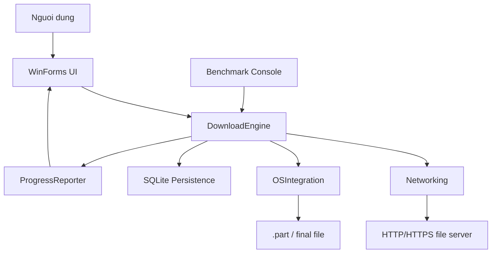
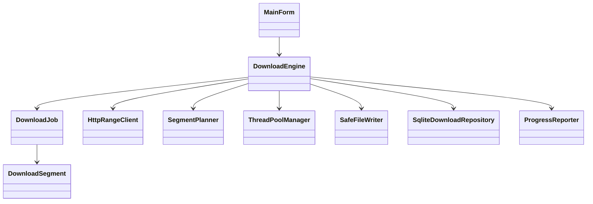
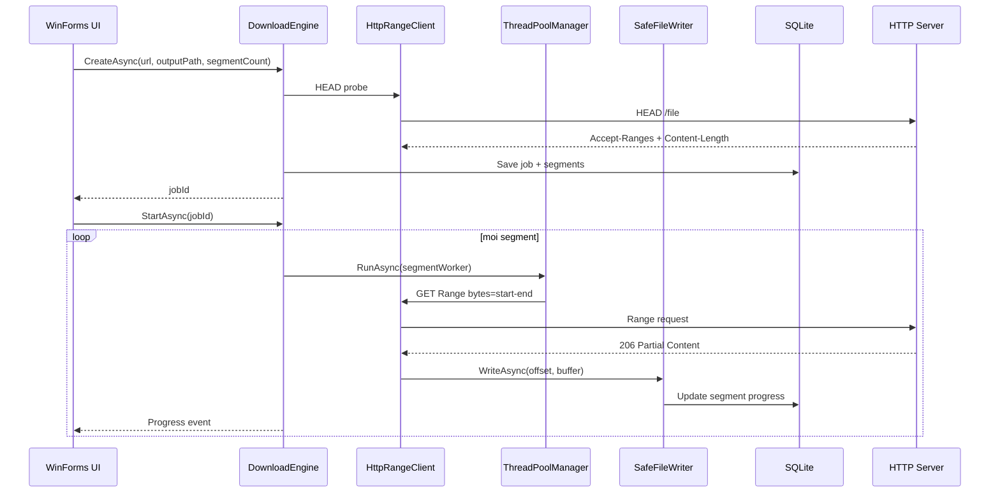

# ARCHITECTURE - pbl4

De tai: **Nghien cuu co che Windows Thread Pool va Overlapped I/O trong viec toi uu hoa toc do va quan ly tai nguyen cho trinh tai xuong HTTP phan doan**.

## 1. Kien truc desktop local

Ung dung khong can web public hay host `localhost`. WinForms goi truc tiep engine local, file duoc tai ve may nguoi dung. Cach nay dung voi muc tieu hoc Windows Thread Pool, Overlapped I/O, socket, disk I/O va quan ly tai nguyen tren may local.

## 2. Module

| Module | Vai tro |
| --- | --- |
| `src/UI` | WinForms app, nhap URL, thread count, pause/resume/cancel |
| `src/Core` | Download engine, state machine, retry, resume, throttle |
| `src/Networking` | HTTP Range client, raw HTTP parser, TCP/UDP probe |
| `src/OSIntegration` | ThreadPool manager, Overlapped file writer, Named Pipe IPC demo |
| `src/Persistence` | SQLite metadata cho resume |
| `src/Benchmark` | Benchmark local 1/4/8 segment |

## 3. Class diagram

## 4. Sequence download nhieu segment

## 5. Mapping yeu cau hoc thuat

| Yeu cau | Code |
| --- | --- |
| Windows Thread Pool | `OSIntegration/ThreadPoolManager.cs`, `Core/DownloadEngine.cs` |
| Overlapped I/O | `OSIntegration/SafeFileWriter.cs` dung `FileOptions.Asynchronous` va `RandomAccess.WriteAsync` |
| Gioi han luong | `SemaphoreSlim` trong `ThreadPoolManager` |
| Critical section | `DownloadJob.TransitionTo`, `SafeFileWriter.WriteAsync`, `SqliteDownloadRepository` |
| Deadlock prevention | Timeout khi doi semaphore/lock, khong giu lock khi network I/O |
| HTTP Range | `Networking/HttpRangeClient.cs`, `HttpRangeParser.cs` |
| Resume | `.part` file + SQLite segment metadata |
| TCP/UDP | `TcpProbeClient.cs`, `UdpProbeClient.cs` |
| Benchmark | `src/Benchmark/Program.cs`, `scripts/benchmark.ps1` |

