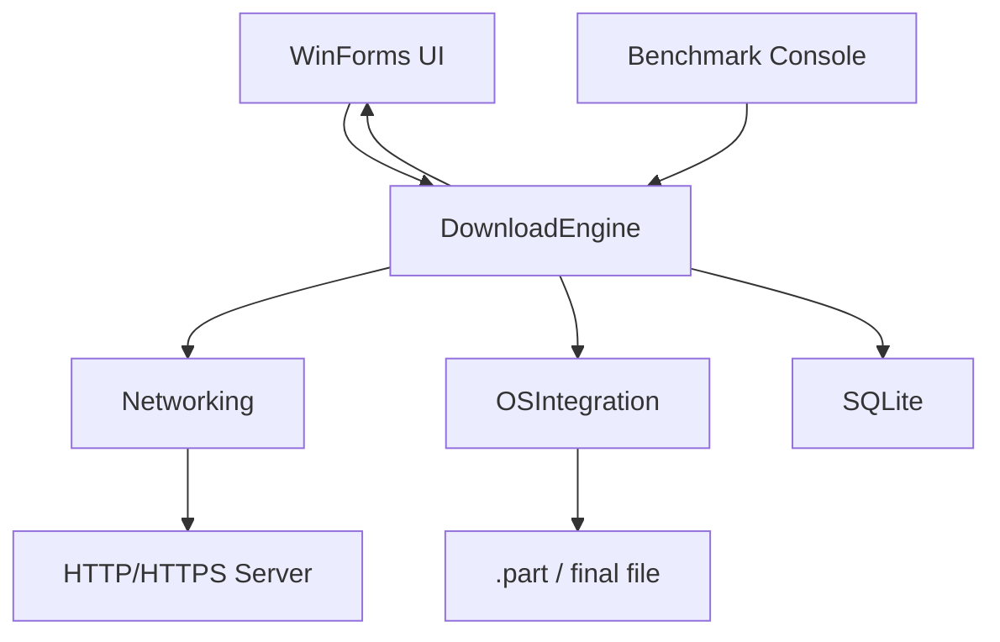

# BAO CAO DO AN PBL4

Ten de tai: **Nghien cuu co che Windows Thread Pool va Overlapped I/O trong viec toi uu hoa toc do va quan ly tai nguyen cho trinh tai xuong HTTP phan doan**.

Project: `pbl4`

Stack: **C# .NET 8 + WinForms + SQLite**

## Chuong 1. Tong quan Windows Thread Pool va Overlapped I/O

Windows Thread Pool giup ung dung thuc thi nhieu tac vu ngan hoac I/O-bound ma khong can tao thread thu cong. Trong project, moi segment download duoc dieu phoi bang `Task.Run`, su dung scheduler cua .NET ThreadPool. `SemaphoreSlim` gioi han so segment chay dong thoi de tranh qua tai CPU, socket, RAM va disk.

Overlapped I/O la co che I/O bat dong bo cua Windows. File duoc mo voi `FileOptions.Asynchronous | FileOptions.RandomAccess`, sau do ghi bang `RandomAccess.WriteAsync` theo offset. Cach nay giup thread giao viec I/O cho kernel thay vi block UI thread khi ghi file lon.

## Chuong 2. HTTP phan doan va kien truc mang

HTTP Range Request cho phep client tai mot khoang byte cua file:

```http
Range: bytes=0-1048575
```

Neu server ho tro, response la `206 Partial Content` kem `Content-Range`. Engine kiem tra `Accept-Ranges: bytes` va `Content-Length`; neu khong ho tro Range thi fallback ve 1 segment de tranh ghi sai file.

Project cung co `TcpProbeClient` de do RTT va `UdpProbeClient` de minh hoa packet loss. Download chinh dung HTTP/HTTPS tren TCP vi can truyen tin cay va dung thu tu.

## Chuong 3. Thiet ke he thong



Ung dung la desktop local app. Khong can web public, khong can server trung gian. File duoc tai truc tiep tu HTTP server ve may nguoi dung.

## Chuong 4. Cai dat va benchmark

| Module | File chinh | Vai tro |
| --- | --- | --- |
| UI | `src/UI/MainForm.cs` | WinForms dashboard |
| Core | `src/Core/DownloadEngine.cs` | Dieu phoi download |
| Networking | `src/Networking/HttpRangeClient.cs` | HTTP Range |
| OSIntegration | `src/OSIntegration/SafeFileWriter.cs` | Overlapped I/O writer |
| Persistence | `src/Persistence/SqliteDownloadRepository.cs` | Resume metadata |
| Benchmark | `src/Benchmark/Program.cs` | So sanh 1/4/8 segment |

Chay benchmark:

```powershell
.\scripts\benchmark.ps1 -Url "https://speed.hetzner.de/100MB.bin"
```

Ket qua:

- `benchmark-results/benchmark.csv`
- `benchmark-results/benchmark-chart.html`

## Chuong 5. Ket luan va huong phat trien

Do an da xay dung duoc trinh tai xuong HTTP phan doan bang WinForms, co ThreadPool, SemaphoreSlim, Overlapped I/O, SQLite resume, HTTP Range, retry, throttle, pause/resume/cancel va benchmark. Huong nay phu hop hoc thuat hon web public vi tai nguyen download nam tren may nguoi dung, khong don tai len server.

Han che:

- Chua co dialog chon file.
- Chua co checksum SHA-256 sau khi tai.
- Proxy/DNS custom moi nam o tang thiet ke, chua dua len UI.

Huong phat trien:

- Adaptive concurrency theo toc do mang.
- Checksum file.
- MSIX/installer de cai nhu ung dung Windows that.

